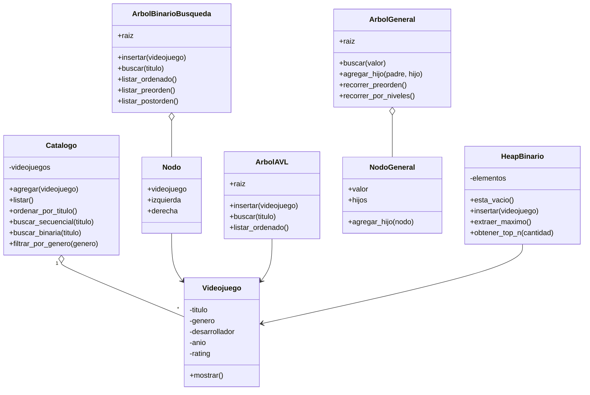

# 03 - Diagrama de clases

## GameFinder

**Grupo 9**

## Descripción

`Videojuego` representa la entidad principal. `Catalogo` administra la colección base. Las estructuras BST, AVL, árbol general y heap utilizan esos datos para resolver los distintos requerimientos de cada etapa del trabajo práctico.
