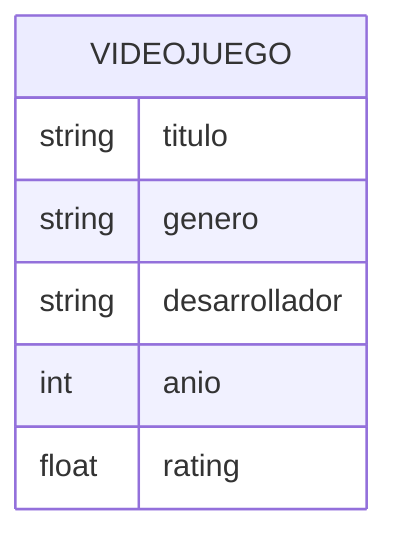

# 04 - Diagrama de datos

## GameFinder

**Grupo 9**

Los datos persistentes se almacenan en `datos/videojuegos.json`.



## Estructura del archivo JSON

Cada elemento representa un videojuego con la siguiente forma:

```json
{
  "titulo": "The Witcher 3",
  "genero": "RPG",
  "desarrollador": "CD Projekt Red",
  "anio": 2015,
  "rating": 9.8
}
```

## Uso de los datos

- `servicios/reader.py` lee el archivo JSON.
- `main.py` transforma cada registro en un objeto `Videojuego`.
- `Catalogo` almacena los objetos para búsquedas y filtros.
- BST y AVL organizan los videojuegos por título.
- El árbol general organiza géneros y títulos jerárquicamente.
- La heap utiliza el rating como prioridad para construir el Top-N.
